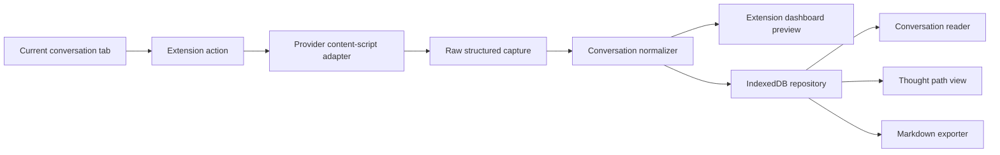
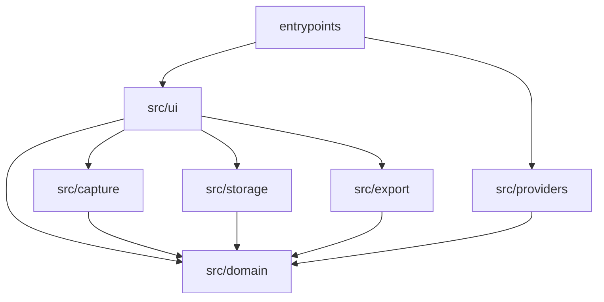

# アーキテクチャ

取得手順と失敗時の表示は [方法](METHOD.md) に従う。この文書は、その手順をどの境界で実装するかを固定する。

## 全体像



ダッシュボード、原文、思考経路、Markdownは、同じ `Conversation` を読む。経路とMarkdownは保存せず、表示または書き出しのたびに作る。

## 技術

- WXT
- React
- TypeScript strict
- Dexie / IndexedDB
- Vitest
- React Testing Library
- happy-dom
- fake-indexeddb

パッケージマネージャはnpmを使う。バックエンド、ホスト型データベース、LLM APIは置かない。

ブラウザ操作のボタンはpopupを持たない。対応会話タブでクリックしたら、そのタブへ取得要求を送り、`dashboard.html` を通常タブで開いて結果を表示する。ダッシュボードが既に開いていれば、そのタブを前面にする。取得元タブのURL遷移や開閉はしない。

## 依存の方向



`src/domain` はブラウザAPI、DOM、Dexie、Reactをimportしない。`src/providers` はDexieとReactをimportしない。providerのHTML解釈は `src/providers` の外へ出さない。

## ディレクトリ

```text
entrypoints/
  background.ts
  dashboard/
    index.html
    main.tsx
    App.tsx
  copilot.content.ts
  chatgpt.content.ts
src/
  domain/
    types.ts
    normalize.ts
    hash.ts
    thoughtPath.ts
    title.ts
  providers/
    copilot/adapter.ts
    chatgpt/adapter.ts
  capture/
    page.ts
    session.ts
  storage/
    db.ts
    repository.ts
  export/
    markdown.ts
  ui/
tests/
  fixtures/copilot/
  fixtures/chatgpt/
```

content scriptの入口は薄く保つ。明示的な取得要求を受けたときだけ `parse(document, url)` を呼び、結果を返す。HTML解釈のテストは、この純粋関数へfixtureのDocumentを渡して行う。

adapterの外へ出るものは `RawCapture` か失敗コードだけである。取得器は交換でき、保存、正規化、思考経路、MarkdownはproviderのDOMを知らない。既存の会話エクスポーターはForkせず、そのMarkdown変換、汎用セレクタ、部分取得の成功もこの境界へ入れない。進め方は [AGENTS.md](../AGENTS.md) に従う。

## manifest

静的なcontent scriptだけを使う。任意コードの実行権限は要らない。content scriptのmatchは、実ページで確認した通常会話と共有会話のパスに限定する。host permissionのmatch patternではpathによる権限制限が保証されないため、対応providerのoriginだけを許可する。

```ts
manifest: {
  name: "Trailogue",
  description: "答えではなく、たどり着き方を残す。",
  action: {},
  permissions: ["tabs"],
  host_permissions: [
    "https://copilot.cloud.microsoft/*",
    "https://chatgpt.com/*",
  ],
}
```

content scriptの一致パターンも同じ4形式に限る。

- `https://copilot.cloud.microsoft/chat/conversation/*`
- `https://copilot.cloud.microsoft/chat/share/*`
- `https://chatgpt.com/c/*`
- `https://chatgpt.com/share/*`

match patternは末尾の追加パスも包含しうるため、`src/capture/page.ts` で識別子が空でない1セグメントだけであることを検証する。クエリとフラグメントは判定から除外する。

`cookies`、`scripting`、`<all_urls>` は宣言しない。content scriptが読み込まれても自動取得はせず、URL形式または既知の会話構造に一致しないページは `unsupported_page` にする。拡張機能はCookie、トークン、providerのlocalStorageを読まない。

## データモデル

```ts
type ProviderId = "copilot" | "chatgpt";
type SourceKind = "conversation" | "shared";
type MessageRole = "user" | "assistant" | "unknown";

type RawMessage = {
  ordinal: number;
  role: MessageRole;
  content: string;
  providerMessageId?: string;
};

type RawCapture = {
  provider: ProviderId;
  sourceUrl: string;
  sourceId: string;
  sourceKind: SourceKind;
  title: string | null;
  parserVersion: string;
  messages: RawMessage[];
};

type Message = {
  id: string;
  ordinal: number;
  role: MessageRole;
  content: string;
  providerMessageId?: string;
};

type Conversation = {
  id: string;
  provider: ProviderId;
  sourceUrl: string;
  sourceId: string;
  sourceKind: SourceKind;
  title: string;
  capturedAt: string;
  parserVersion: string;
  contentHash: string;
  messages: Message[];
};

type ThoughtNode = {
  id: string;
  ordinal: number;
  role: MessageRole;
  messageId: string;
};
```

`Message.id` は、その記録の中で安定であればよい。providerの発言IDが無い場合はordinalから作る。順序の正本は `ordinal` である。

`Conversation.id` はローカルのUUIDである。`capturedAt` は保存時のISO 8601 UTCである。

## 正規化とハッシュ

normalizerは `RawCapture` を `Conversation` の保存前データへ変える。

- `ordinal` の昇順に並べ、0から振り直す
- 各本文の前後空白を除く
- 改行をLFへ揃える
- それ以外の本文は変えない
- 空になった本文の発言も削除しない
- タイトルは [方法](METHOD.md) の優先順で決める

内容ハッシュは、次のcanonical JSONをUTF-8で符号化したSHA-256の小文字16進である。

```ts
JSON.stringify({
  v: 1,
  provider,
  sourceId,
  messages: messages.map((message) => ({
    ordinal: message.ordinal,
    role: message.role,
    content: message.content,
  })),
})
```

ハッシュに含めないものは `id`、`title`、`capturedAt`、`parserVersion`、`sourceUrl`、`sourceKind` である。`sourceId` は含める。別の会話で本文が偶然同じでも、別の軌跡として残すためである。通常ページと共有ページから同じprovider会話IDを確認できた場合は、同じ `sourceId` になるため重複しない。`v` はハッシュ形式の版であり、parserの版とは別である。`v` を変えると同一会話が別記録になるため、変えるときは移行方法を同じ変更に含める。

同一 `contentHash` は1件だけ保存する。同じ `sourceId` でハッシュが違う記録は、別の `Conversation` として併存させる。

## 思考経路とMarkdown

`deriveThoughtPath(conversation)` は発言ごとに1ノードを返す。ノードは `messageId` で本文を参照する。ノード用の別本文は持たない。

Markdownは `toMarkdown(conversation)` の純粋関数で作る。ファイルはUTF-8、改行はLF、末尾改行を1つ付ける。

```md
# {title}

- Provider: {provider}
- Source: {sourceUrl}
- Captured: {capturedAt}
- Parser: {parserVersion}

---

**1. ユーザー**

{content}

---

**2. Copilot**

{content}
```

見出しの番号は、保存値 `ordinal` に1を足した表示順である。assistantの表示名は、providerがcopilotなら `Copilot`、chatgptなら `ChatGPT` とする。役割不明は `不明` とする。発言本文は引用符やコードフェンスで包まない。本文中のMarkdownをエスケープしない。これは忠実な書き出しであり、Trailogueが本文を整形し直す処理ではない。

画面の既定表示は、保存した本文のpre-wrapである。Markdown描画を追加する場合も元の本文は残し、生HTMLは無効にしてからsanitizeする。

## 保存

データベース名は `trailogue`、Dexieのschema versionは1とする。

```ts
conversations: "id, provider, sourceId, &contentHash, capturedAt"
```

repositoryは `Conversation` だけを受け取る。挿入前にハッシュで検索し、既存があれば既存を返す。物理削除と上書き更新はMVPの操作に含めない。

未保存プレビューはReactの状態に置く。保存失敗後もその状態から `toMarkdown` を呼べるようにする。

## adapter契約

各adapterは `parserVersion` を持つ。Copilotの初期値は `copilot-1`、ChatGPTの初期値は `chatgpt-1` とする。DOMや埋め込み形式を変えて解釈を直すときは、この値を上げる。

戻り値は成功時の `RawCapture` か、次の失敗である。

| code | 意味 |
| --- | --- |
| `login_required` | サインイン画面であり、会話はまだ無い |
| `not_ready` | 会話ページだが、会話の描画または埋め込みが未完了 |
| `empty_conversation` | 構造は認識し、発言が0件 |
| `incomplete_conversation` | 構造は認識したが、全発言を取得できない |
| `unrecognized_structure` | 読み込み済みだが、既知の構造に一致しない |
| `unsupported_page` | 対応ホスト外、または会話ページではない |

fixtureはproviderごとに、通常会話の成功、共有会話の成功、サインイン画面、空の会話、会話不完全、構造不明を用意する。成功fixtureは期待する役割、順序、本文と一致させる。失敗fixtureが `RawCapture` を返したらテストを失敗させる。実ページで通常会話をまだ確認できていないproviderでは、通常会話fixtureとその本番セレクタを推測で作らず、未対応であることを明記する。

セレクタと埋め込み形式の解析は、fixtureで確認できたものだけを書く。確認できないCopilotの内部APIは推測で呼ばない。

Copilot共有ページでは、実HTMLのinline scriptにある `window.__staticRouterHydrationData = JSON.parse(...)` の `loaderData["chat-share-redeem"].store.rawConversationResponse` に全50発言が入り、仮想化されたDOMには同時に4ターンだけが存在する例を確認している。content scriptからページ側のJavaScript変数へアクセスするのではなく、Document内の該当script要素のテキストを読み、代入されているJSON文字列だけを `JSON.parse` する。`eval` やページコンテキストへのコード注入は使わない。この形式では `messages` の `author`、`text`、`messageId`、配列順を使い、DOMへフォールバックしない。fixtureへはこの契約を再現する最小データだけを置き、conversation transfer token、reconnect token、他のチャット履歴、プロフィール画像を含む保存HTML全体を入れない。

## 画面

ダッシュボードは1つの拡張ページで、次を切り替える。

- 取得元タブの状態と保存済み一覧
- 保存前プレビュー
- 原文
- 思考経路
- Markdownの書き出し

一覧の各行は、タイトル、provider、取得日時、発言数を示す。同じ `sourceId` の記録が複数あれば、取得日時で区別する。

取得セッションの分岐は `src/capture/session.ts` の純粋関数に置く。現在のタブへ取得要求を送る処理、ダッシュボードを開く処理、2秒間隔の再取得は、その関数の結果を実行する側へ分ける。

## 検証

自動テストで固定するもの:

- 対応ホストと対象外ページの判定
- 正規化、ハッシュの安定性、同一ハッシュの重複判定
- 思考経路が全発言を順序どおり含むこと
- provider fixtureの成功と4種の失敗
- Markdownの全文が本文と一致すること
- repositoryが同じハッシュを2件挿入しないこと
- 保存失敗後もプレビューからMarkdownを作れること

実装後の手動確認:

1. EdgeまたはChromeへ、ビルドした拡張を読み込む
2. Copilotで通常会話を開き、そのタブで拡張機能ボタンを押す
3. プレビューの発言が会話全体の順序と本文に一致することを確認して保存する
4. ダッシュボードを開き直し、原文、思考経路、Markdownを確認する
5. 同じ会話を再取得し、重複保存されないことを確認する
6. Copilotの共有会話、ChatGPTの通常会話と共有会話で2から5を行う
7. providerのホーム、設定、一覧で実行し、保存されないことを確認する
8. 対応外ホストで実行し、ページを取得しないことを確認する

providerの埋め込み形式とDOMは予告なく変わる。手動確認で構造不明になった場合は、機密値を除いたfixtureを更新してadapterを直す。ページ全体のテキスト抽出や、仮想DOMに偶然存在する一部分へフォールバックして成功にしない。
