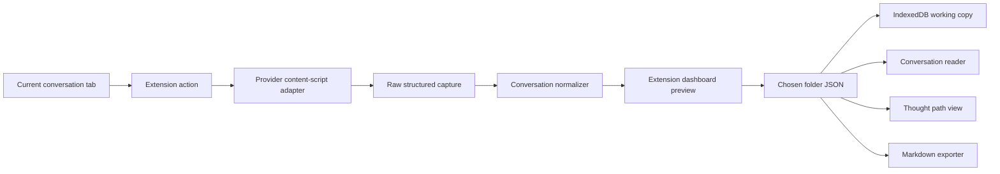
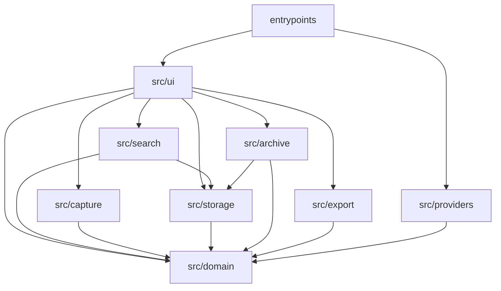

# アーキテクチャ

取得手順と失敗時の表示は [方法](METHOD.md) に従う。この文書は、その手順をどの境界で実装するかを固定する。

## 全体像



ダッシュボード、原文、思考経路、Markdownは、同じ `Conversation` を読む。保存の正本は、利用者が選んだフォルダのJSONである。経路とMarkdownは保存せず、その `Conversation` から表示または書き出しのたびに作る。

## 技術

- WXT
- React
- TypeScript strict
- Dexie / IndexedDB
- Vitest
- React Testing Library
- happy-dom
- fake-indexeddb

パッケージマネージャはnpmを使う。バックエンド、ホスト型データベース、外部のLLM APIは置かない。似た言葉の検索だけ、利用者がローカルで動かしている Ollama の embedding API を呼ぶ。送り先は `http://127.0.0.1:11434` だけである。

ブラウザ操作のボタンはpopupを持たない。対応会話タブでクリックしたら、そのタブを読み直さず取得要求を送る。`dashboard.html` を通常タブで開き、結果を表示する。ダッシュボードが既に開いていれば、そのタブを前面にする。別のURLへは移さず、取得元タブの開閉はしない。Copilotは、そのタブを開いたときの最初のHTMLに含まれた hydration を使う。開いたあと足した発言は、利用者がページを読み直すまで取得に入らない。

Braveでは、起動時の brand に Brave があるとき、ボタンにバッジとツールチップを出す。クリックとインストール直後はダッシュボードを開くだけで、取得要求は送らない。ダッシュボードは `navigator.brave.isBrave()` が true のとき、既存の画面を出さず同じ一文だけを示す。

## 依存の方向



`src/domain` はブラウザAPI、DOM、Dexie、Reactをimportしない。`src/providers` はDexieとReactをimportしない。providerのHTML解釈は `src/providers` の外へ出さない。一致判定と、ベクトルが揃ったあとの近傍の並びは `src/search` の純粋関数とし、ブラウザAPI、DOM、Dexie、React、OllamaへのHTTPをimportしない。OllamaへのHTTPは `src/search/ollama.ts` だけが行う。検索は `src/providers` をimportしない。

## ディレクトリ

```text
entrypoints/
  background.ts
  dashboard/
    index.html
    main.tsx
    App.tsx
  copilot.content.ts
  chatgpt.content.ts
src/
  domain/
    types.ts
    normalize.ts
    hash.ts
    thoughtPath.ts
    title.ts
  providers/
    copilot/adapter.ts
    chatgpt/adapter.ts
  capture/
    page.ts
    session.ts
    batch.ts
    sidebar.ts
  storage/
    db.ts
    repository.ts
  archive/
    conversationFile.ts
    fileSystemArchive.ts
  export/
    markdown.ts
  search/
    text.ts
    rank.ts
    ollama.ts
  ui/
tests/
  fixtures/copilot/
  fixtures/chatgpt/
```

content scriptの入口は薄く保つ。取得要求では `parse(document, url)` の結果をそのまま返す。ページ表示とURL変化では、同じ `parse` から発言の指紋だけを作り、保存しない。Copilotの content script はそれに加えて `document_start` で hydration script のテキストを保持する。保持は取得でも保存でもない。サイドバーの一覧要求には、確認できた会話識別子だけを返し、本文は返さない。HTML解釈のテストは、この純粋関数へfixtureのDocumentを渡して行う。

adapterの外へ出るものは `RawCapture` か失敗コードだけである。取得器は交換でき、保存、正規化、思考経路、MarkdownはproviderのDOMを知らない。既存の会話エクスポーターはForkせず、そのMarkdown変換、汎用セレクタ、部分取得の成功もこの境界へ入れない。進め方は [AGENTS.md](../AGENTS.md) に従う。

## manifest

静的なcontent scriptだけを使う。任意コードの実行権限は要らない。content scriptのmatchは、ホームから会話へのソフト遷移でも script が居られるよう、対応providerのorigin全体にする。保存の対象は `src/capture/page.ts` が空でない1セグメントと判定した会話ページだけである。host permissionのmatch patternではpathによる権限制限が保証されないため、対応providerのoriginだけを許可する。

```ts
manifest: {
  name: "Trailogue",
  description: "答えではなく、たどり着き方を残す。",
  action: {},
  permissions: ["tabs"],
  host_permissions: [
    "https://copilot.cloud.microsoft/*",
    "https://chatgpt.com/*",
    "http://127.0.0.1:11434/*",
  ],
}
```

content scriptの一致パターンは、次のoriginである。

- `https://copilot.cloud.microsoft/*`
- `https://chatgpt.com/*`

会話かどうかは `src/capture/page.ts` で判定する。対象は空でない1セグメントの通常会話と共有会話だけである。クエリとフラグメントは判定から除外する。

`cookies`、`scripting`、`<all_urls>` は宣言しない。content scriptが読み込まれても自動保存はしない。会話URLでは照合のために `parse` し、指紋だけをbackgroundへ送る。取得ボタンによる保存用の取得は、明示的な要求のときだけダッシュボードへ渡す。URL形式または既知の会話構造に一致しないページは、照合ではバッジを消し、取得では `unsupported_page` にする。拡張機能はCookie、トークン、providerのlocalStorageを読まない。

## データモデル

```ts
type ProviderId = "copilot" | "chatgpt";
type SourceKind = "conversation" | "shared";
type MessageRole = "user" | "assistant" | "unknown";

type RawMessage = {
  ordinal: number;
  role: MessageRole;
  content: string;
  providerMessageId?: string;
};

type RawCapture = {
  provider: ProviderId;
  sourceUrl: string;
  sourceId: string;
  sourceKind: SourceKind;
  title: string | null;
  parserVersion: string;
  messages: RawMessage[];
};

type Message = {
  id: string;
  ordinal: number;
  role: MessageRole;
  content: string;
  providerMessageId?: string;
};

type Conversation = {
  id: string;
  provider: ProviderId;
  sourceUrl: string;
  sourceId: string;
  sourceKind: SourceKind;
  title: string;
  capturedAt: string;
  parserVersion: string;
  contentHash: string;
  messages: Message[];
};

type ThoughtNode = {
  id: string;
  ordinal: number;
  role: MessageRole;
  messageId: string;
};
```

`Message.id` は、その記録の中で安定であればよい。providerの発言IDが無い場合はordinalから作る。順序の正本は `ordinal` である。

`Conversation.id` はローカルのUUIDである。`capturedAt` は保存時のISO 8601 UTCである。

## 正規化とハッシュ

normalizerは `RawCapture` を `Conversation` の保存前データへ変える。

- `ordinal` の昇順に並べ、0から振り直す
- 各本文の前後空白を除く
- 改行をLFへ揃える
- それ以外の本文は変えない
- 空になった本文の発言も削除しない
- タイトルは [方法](METHOD.md) の優先順で決める

内容ハッシュは、次のcanonical JSONをUTF-8で符号化したSHA-256の小文字16進である。

```ts
JSON.stringify({
  v: 1,
  provider,
  sourceId,
  messages: messages.map((message) => ({
    ordinal: message.ordinal,
    role: message.role,
    content: message.content,
  })),
})
```

ハッシュに含めないものは `id`、`title`、`capturedAt`、`parserVersion`、`sourceUrl`、`sourceKind` である。`sourceId` は含める。別の会話で本文が偶然同じでも、別の軌跡として残すためである。通常ページと共有ページから同じprovider会話IDを確認できた場合は、同じ `sourceId` になるため重複しない。`v` はハッシュ形式の版であり、parserの版とは別である。`v` を変えると同一会話が別記録になるため、変えるときは移行方法を同じ変更に含める。

同一 `contentHash` は1件だけ保存する。同じ `sourceId` でハッシュが違う記録は、別の `Conversation` として併存させる。

## 思考経路とMarkdown

`deriveThoughtPath(conversation)` は発言ごとに1ノードを返す。ノードは `messageId` で本文を参照する。ノード用の別本文は持たない。

Markdownは `toMarkdown(conversation)` の純粋関数で作る。ファイルはUTF-8、改行はLF、末尾改行を1つ付ける。

```md
# {title}

- Provider: {provider}
- Source: {sourceUrl}
- Captured: {capturedAt}
- Parser: {parserVersion}

---

**1. ユーザー**

{content}

---

**2. Copilot**

{content}
```

見出しの番号は、保存値 `ordinal` に1を足した表示順である。assistantの表示名は、providerがcopilotなら `Copilot`、chatgptなら `ChatGPT` とする。役割不明は `不明` とする。発言本文は引用符やコードフェンスで包まない。本文中のMarkdownをエスケープしない。これは忠実な書き出しであり、Trailogueが本文を整形し直す処理ではない。

画面の既定表示は、保存した本文のpre-wrapである。Markdown描画を追加する場合も元の本文は残し、生HTMLは無効にしてからsanitizeする。

## 保存

保存の正本は、利用者が一度選んだフォルダに置く `{contentHash}.json` である。中身は `Conversation` のJSON（UTF-8）であり、本文は変えない。ファイル名と中身の `contentHash` は、保存時と同じ計算で本文から出したSHA-256と一致するときだけ記録として読む。一致しないファイルは読まず、消さない。有効なファイルが既にあるときは書き直さない。同名でも検証に失敗するファイルだけ、保存する `Conversation` で書き直す。

この読み書きは `src/archive/conversationFile.ts` に置く。DOMもDexieも知らない。ダッシュボードは `ConversationArchive`（書く、ハッシュで探す、一覧する、フォルダを開く、選んだ1件を消す）を受け取る。Edge / Chromeの実装は `src/archive/fileSystemArchive.ts` で、ダッシュボードから `showDirectoryPicker` を使う。ディレクトリハンドルはIndexedDBに保持する。ハンドルが消えてもファイルは残る。権限があるときだけフォルダを自動で読む。権限が無いときは「記録フォルダを開く」で同じフォルダを選び直し、JSONを読んで一覧とキャッシュを戻す。Chromeは再起動後に権限の再確認を求めることがある。

IndexedDB の `conversations` は、最後に読めたフォルダのキャッシュである。正本は検証できた JSON である。フォルダが読めたとき、キャッシュは検証できた JSON に合わせる。キャッシュにあってファイルが無い行は、キャッシュから外す。その行から JSON は作らない。一覧は、フォルダが読めるときはファイルを正とする。一覧が失敗したとき、および権限が無いあいだは、キャッシュを消さず、その一覧を出し、フォルダが未接続であることを示す。相手ブラウザの追加と削除は、このブラウザが次にフォルダを読んだときにキャッシュへ入る。ダッシュボードが前面に戻ったときも、フォルダが読めるなら読み直す。

作業用データベース名は `trailogue` とする。Dexieのschema versionは3とする。`conversations` の索引はversion 1のままである。

```ts
conversations: "id, provider, sourceId, &contentHash, capturedAt"
archiveHandles: "id, folderAligned"
```

`archiveHandles` はversion 2で足す。中身は選んだフォルダのハンドル1件である。version 3は同じテーブルに `folderAligned` を足す。フォルダ整合のために新しいテーブルは作らない。フォルダからキャッシュを揃えたときだけ、揃った印をこのテーブルに残す。印が無いキャッシュは、取り込み済の判定に使わない。repositoryは `Conversation` だけを受け取る。`insert` は挿入前にハッシュで検索し、既存があれば既存を返す。上書き更新はしない。ファイルの有効な JSON も上書きしない。キャッシュをフォルダへ合わせるときだけ、同じ `contentHash` の行を、読めたファイルの `Conversation` で置き換える。物理削除は、利用者が一覧で選んだ1件の検証できた JSON に限る。その JSON を消せたとき、同じハッシュのキャッシュ行も消す。JSON が残ったときは、その JSON からキャッシュへ戻す。同じ `sourceId` の別ハッシュ、検証に失敗したファイル、フォルダハンドルは残す。検証できた JSON、別ハッシュ、検証に失敗したファイル、フォルダハンドルを、利用者の明示以外で消さない。キャッシュ行は記録ではない。フォルダが読めるとき、検証できたファイルに無いキャッシュ行は外してよい。フォルダが読めないときは、キャッシュも消さない。Dexieへの挿入は、フォルダへ書けたあとで行う。再表示と削除は同時に走らせない。

未保存プレビューはReactの状態に置く。フォルダに書けなかったあとでも、その状態から `toMarkdown` を呼べるようにする。経路とMarkdownは、ファイルから読んだ `Conversation` から毎回作る。

## 再訪

再訪の契約は [方法](METHOD.md) に従う。検索が読むのは、検証できた `Conversation` だけである。未保存プレビューは検索しない。

一致判定は `src/search/text.ts`、近傍の並びは `src/search/rank.ts` に置く。どちらも保存済み本文を書き換えない。Ollama が返すベクトルの次元とモデル名は契約で固定しない。契約が固定するのは次である。原本に書かない。送り先は `http://127.0.0.1:11434` だけである。応答が無いとき、似た言葉を成功にしない。ヒットは記録と発言の位置である。

索引とベクトルを作業用データベースに置くときは、`conversations` とも `archiveHandles` とも別のテーブルにする。そのとき schema version を上げる。中身は `contentHash` と発言の位置に紐づく派生物である。repository の `insert` は `Conversation` だけを受け取る。索引の書き込みは、その `insert` に乗せない。索引から JSON は作らない。フォルダが読めたとき、検証できたファイルに無い索引は外す。フォルダが読めないときは消さない。利用者が記録を消したとき、同じ `contentHash` の索引も消す。

## adapter契約

各adapterは `parserVersion` を持つ。Copilotの初期値は `copilot-1`、ChatGPTの初期値は `chatgpt-1` とする。DOMや埋め込み形式を変えて解釈を直すときは、この値を上げる。

戻り値は成功時の `RawCapture` か、次の失敗である。

| code | 意味 |
| --- | --- |
| `login_required` | サインイン画面であり、会話はまだ無い |
| `not_ready` | 会話ページだが、会話の描画または埋め込みが未完了 |
| `empty_conversation` | 構造は認識し、発言が0件 |
| `incomplete_conversation` | 構造は認識したが、全発言を取得できない |
| `unrecognized_structure` | 読み込み済みだが、既知の構造に一致しない |
| `unsupported_page` | 対応ホスト外、または会話ページではない |

fixtureは、確認できた通常会話と共有会話の成功、空の会話、会話不完全、構造不明を用意する。成功fixtureは期待する役割、順序、本文と一致させる。失敗fixtureが `RawCapture` を返したらテストを失敗させる。サインイン画面は未確認のため、そのfixtureとセレクタは実物のHTMLが取れてから置く。

セレクタと埋め込み形式の解析は、fixtureで確認できたものだけを書く。確認できないCopilotの内部APIは推測で呼ばない。

Copilotは通常会話と共有会話のどちらも、inline script の `window.__staticRouterHydrationData = JSON.parse(...)` から読む。ページ側のJavaScript変数は見ない。代入されているJSON文字列だけを `JSON.parse` する。`eval` やページコンテキストへのコード注入は使わない。

- 通常会話: `loaderData["chat-history"].store.rawConversationResponse`
- 共有会話: `loaderData["chat-share-redeem"].store.rawConversationResponse`

使うのは `messages` の配列順、`author`（`user` はそのまま、`bot` は `assistant`、それ以外は `unknown`）、`text`、`messageId`、`chatName`、照合用の `conversationId` と `conversationDebugMetrics.messageCount` である。`text` が文字列のときはそれを本文にする。空文字も本文であり、カードは見ない。`text` が無く、`adaptiveCards` の各 `body` が `TextBlock` だけで `text` が文字列のときは、その文字列を出現順に改行でつなぐ。カードを Markdown へ組み替えない。`body` に `TextBlock` 以外がある、または `TextBlock.text` が文字列でないときは `incomplete_conversation` とする。`text` も読めるカードも無い発言は空の本文のまま残す。この読み方の版は `copilot-2` である。サイドバーの履歴や `loaderData.chat` は使わない。`messageCount` が配列長と違うときは `incomplete_conversation`、配列が0件のときは `empty_conversation` とする。通常会話では `conversationId` がURLのパス識別子と一致するときだけ採用し、`sourceId` はその識別子にする。共有会話で `conversationId` があるときはそれを `sourceId` にし、無いときはURLのパスセグメントを使う。共有トークンはデコードしない。

この script は `#root` の中にあり、Reactのハイドレーションで消える。`document_start` の時点ではまだ script が無いので、MutationObserver が script 要素の追加を見てテキストを残す。取得要求では Document 内の script を優先し、無ければ同じパスで保持したテキストを使う。別会話の保持分は捨て、`#m365-copilot-app-layout-root` だけがあるときは `incomplete_conversation` とする。仮想スクロール上の発言へはフォールバックしない。Document の `readyState` が `loading` で script もまだ無いときは `not_ready` とする。

共有ページでは、この hydration に全発言が入り、仮想化されたDOMには同時に一部のターンだけがある例を確認している。通常会話でも、最初のHTMLの `chat-history` に全発言があり、描画後のDOMは窓だけになる例を確認している。

ChatGPT共有会話は `script#__WEB_MOBILE_DATA__` の `conversation.messages` を読む。各要素の `content`、`role`（`user` と `assistant` 以外は `unknown`）、`id`、タイトルの `conversation.title` を使う。`userMessageCount` がユーザー発言数と違うときは `incomplete_conversation` とする。このJSONが読めたときは描画DOMを使わない。`sourceId` はURLの共有パスセグメントである。

ChatGPT通常会話で確認できたページには、本文の埋め込みが無く、仮想化も無かった。`data-chatgpt-search-message-ids` を文書順に読む。役割は `data-conversation-role="assistant"`、`data-chatgpt-search-unit-key` の末尾、または見出し「あなたの発言:」で決める。ユーザー本文は `data-search-result-target`、assistant本文は `data-markdown-text-style="assistant-message"` の表示テキストである。段落、リスト、コードブロックの表示テキストを含め、その要素の中にある `data-search-result-target` へ本文を切り替えない。本文のある最初のユーザー発言より後に空の assistant 本文があるときは、描画前の殻として `not_ready` とし、空の成功にしない。発言がまだ無く、URLの会話識別子と同じ `data-conversation-id` を持つ textarea と、空の `[data-thread-user-message-navigation-content]` があるときも `not_ready` とする。サイドバーの履歴や起動時のbootstrapは本文に使わない。クラス名に `data-virtualized-turn-content` と書かれているだけでは仮想化とみなさない。属性としてその要素があるページは `incomplete_conversation` とし、スクロールでは集めない。本文のある最初のユーザー発言より前は残さない。空白だけのユーザー本文も手前に含める。残った発言の順序は振り直す。本文のあるユーザーが1件も無いときは `empty_conversation` とする。そのユーザーより後の空本文は残す。この読み方の版は `chatgpt-4` である。タイトルは、サイト名 `ChatGPT` 以外の document title を使う。ChatGPTのサイドバーは順次取り込みの対象にしない。見えている範囲だけでも成功になり、短い記録が別の記録として残るためである。

サインイン画面のDOMは未確認なので、`login_required` を返すセレクタは置いていない。既知の構造が無い読み込み済みDocumentは `unrecognized_structure` である。

fixtureへはこの契約を再現する最小データだけを置く。conversation transfer token、reconnect token、他のチャット履歴、プロフィール画像を含む保存HTML全体は入れない。

## 画面

ダッシュボードは1つの拡張ページで、次を切り替える。

- 取得元タブの状態と保存済み一覧
- 保存前プレビュー
- 原文
- 思考経路
- Markdownの書き出し

一致検索は机にある。クエリが空のあいだ、玄関は今のままである。ヒットを選ぶと、その発言がある経路を開く。拡張のダッシュボードは採取と一覧のままである。

一覧の各行は、タイトル、provider、取得日時、発言数を示す。同じ `sourceId` の記録が複数あれば、取得日時で区別する。各行と、開いている記録から、その1件を削除できる。削除の前にタイトルと provider を確認する。フォルダが読めないときは削除できない。フォルダが未選択のとき、および権限が切れているときは、一覧の上部にその状態とフォルダを開く操作を出す。プレビューには出さない。

会話ページを開いたとき、および同じ文書内の遷移で、そのタブのツールバーに取り込み状態を出す。保存はしない。フォルダの権限が `granted` で、キャッシュをそのフォルダから揃えたときだけ、済、未、差を出す。差のツールチップは、増えた、表示が短い、途中の窓、内容が変わったを分ける。描画待ちは確認中、全件を確認できないページは照合できない、フォルダを読めないときは未確認とする。未確認のときは、キャッシュに同じ `sourceId` があっても未取り込みとは出さない。会話ページでなくなったタブのバッジは消す。Braveのバッジは変えない。サービスワーカーの生存中、フォルダ一覧からの揃えは一度だけ行う。失敗したときは、次の照合で揃え直す。

取得セッションの分岐は `src/capture/session.ts` の純粋関数に置く。取り込み状態の比較は `src/domain/importStatus.ts` の純粋関数に置く。サイドバーの順次取り込みの進行は `src/capture/batch.ts` の純粋関数に置く。現在のタブへ取得要求を送る処理、ダッシュボードを開く処理、2秒間隔の再取得、開いているCopilotの通常会話タブを識別子ごとに開く処理は、その関数の結果を実行する側へ分ける。一覧は開始時の文書から一度だけ読み、移動先のサイドバーは読まない。保存完了は、各会話のJSONがフォルダに書けたときである。失敗した会話は、開始時のタイトルと識別子を実行中のパネルと終了後の保存一覧に残す。タイトルが空のときは識別子だけを出す。次の一括を始めるまで残し、以前の記録は上書きしない。

## 検証

自動テストで固定するもの:

- 対応ホストと対象外ページの判定
- 正規化、ハッシュの安定性、同一ハッシュの重複判定
- 取り込み状態は、一致、世代なし、延長、短縮、途中の窓、分岐を分ける。一致は他の世代に勝ち、延長は短縮に勝つ
- フォルダを読めないとき、キャッシュが一致していても未確認である
- 思考経路が全発言を順序どおり含むこと
- provider fixtureの成功と4種の失敗
- Markdownの全文が本文と一致すること
- repositoryが同じハッシュを2件挿入しないこと
- 検証済みJSONが同じ `Conversation` に戻ること。本文を変えたファイルは不採用になること
- 有効なファイルを上書きせず、検証に失敗した同名ファイルだけを置き換えること
- フォルダへ書けないとき、作業用記録へ挿入せずプレビューが残ること
- 作業用記録が空でも、フォルダのファイルから同一ハッシュと原文を戻せる
- 保存失敗後もプレビューからMarkdownを作れること
- 利用者が選んだ1件だけを、検証済みのファイルと作業用の1行から消すこと。別ハッシュ、検証に失敗したファイル、フォルダハンドルは残ること
- フォルダが読めないときは消さないこと
- 削除した記録は、再表示しても書き戻らないこと
- フォルダが読めたとき、ファイルが無いキャッシュ行は消え、その行から JSON を作らないこと
- 同じハッシュのキャッシュ行は、読めたファイルの `Conversation` で置き換わること
- フォルダが読めるときの同一内容は、検証できた JSON だけで判定すること
- 一致検索は、保存済み本文の部分文字列を含む発言をすべて返すこと。本文は変わらないこと
- ヒットが指す記録と発言を、その JSON から原文のまま開けること
- 索引とベクトルを `Conversation` の JSON に書かないこと
- Ollama が応答しないとき、似た言葉を成功にしないこと

実装後の手動確認:

1. EdgeまたはChromeへ、ビルドした拡張を読み込む
2. Copilotで通常会話を開き、そのタブで拡張機能ボタンを押す。ボタンはページを読み直さない
3. プレビューの発言が会話全体の順序と本文に一致することを確認して保存する。初回の保存で記録フォルダを選ぶ
4. ダッシュボードを開き直し、原文、思考経路、Markdownを確認する
5. 同じ会話を再取得し、重複保存されないことを確認する。選んだフォルダのJSONが、拡張機能のデータを消したあとも開き直せて、同じ原文になることを確認する
6. Copilotの共有会話、ChatGPTの通常会話と共有会話で2から5を行う
7. providerのホーム、設定、一覧で実行し、保存されないことを確認する
8. 対応外ホストで実行し、ページを取得しないことを確認する

providerの埋め込み形式とDOMは予告なく変わる。手動確認で構造不明になった場合は、機密値を除いたfixtureを更新してadapterを直す。ページ全体のテキスト抽出や、仮想DOMに偶然存在する一部分へフォールバックして成功にしない。
