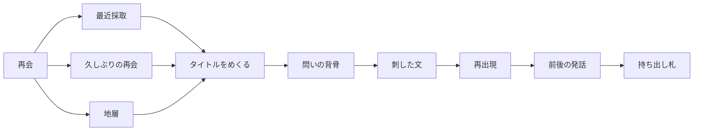

# 再会

この文書は実装契約ではない。保存の次に見ている方向である。矛盾するときは [AGENTS.md](../AGENTS.md)、[方法](METHOD.md)、[アーキテクチャ](ARCHITECTURE.md) を優先する。MVPの成功条件は変えない。

今の思考経路は、方法のとおり、保存済み発言を順序どおり全文で並べたものである。この文書が書く経路は、まだ方法へ昇格していない。

## 流れ

採取する、忘れる、また会う。

玄関は再会である。入り方は日によって変わる。ある日は昔の自分に会う。別の日は、去年の春頃から入る。タイムラインを最初の問いの形にはしない。

再会の机は、保存フォルダを開く。拡張機能の画面は、採取と保存前のプレビューの場所である。めくりのためにそこへ戻らない。

## 入口

入口は三つである。

- 最近採取。採取したばかりの自分。
- 久しぶりの再会。しばらく会っていない自分。開いていない記録の戸は、この奥にある。地層とは別の入口にしない。
- 地層。時期から入る。去年の春頃、のように。

地層は玄関の主役にしない。入口としては隠さない。中央は最近採取の束、奥の一枚は久しぶりの再会、脇の縁は地層である。三つとも、入った先でタイトルをめくる。統計も推薦文も付けない。本文を開くのは、タイトルの次である。

採取日は、会話が生まれた日とは別である。Trailogueがその記録に気づいた日である。同じ暦日に採取した記録は、その日の地層として折りたたむ。開いた順は、その日に残っていた並びである。原本の日時は書き換えない。

同じ会話の世代は、行を増やさず、一つの表紙に年輪として足す。

## 原文と経路

原文は全文の標本である。

経路の節はユーザー発言である。あいだの応答は、件数と文字量だけを経路に残す。たとえば「応答3件・合計4200文字」である。その節を開くと原文がそのまま出る。本文の短縮は出さない。問いだけの列にはしない。

気持ちが変わった箇所は推定しない。

## モチーフ

画面に出るテーマは、本人が刺した文を根拠にしたモチーフである。索引語、候補、頻出句は裏に置く。いま脇へ寄せるのは同じ文字列である。あとから、LLMが読んでいる文の脇へ候補を気づかせる余地は残す。LLMは棚へ並べず、名前を付けず、要約しない。刺すのは本人である。重要度も自動タイトルも作らない。出現回数は、刺せる条件にしない。一度しか出ていない文も、刺せばモチーフになる。

モチーフは、名前と、根拠となる刺した文を分けて持つ。仮の名前は、最初に刺した文でよい。同一性は、文字列が同じであることではない。近い文を一つに束ねるのは本人だけである。機械は束ねない。この束ねは今は作らず、名前と根拠が分かれられる形だけ残す。

再出現は、そのモチーフに足された根拠を採取順にたどる。他の記録に同じ文字列があることは、裏方が候補として手元へ寄せ、刺したときだけ根拠になる。棚に並ぶのは、刺したあとの人間の層だけである。文字列を含む発言を、モチーフの根拠として自動では集めない。

モチーフを開くと、根拠として足した刺した文が、採取順に原文のまま並ぶ。各箇所の直前と直後のユーザー発言も、原文のまま添える。

## 持ち出し

持ち出しは原文だけである。次の案は書かない。コピーして新しい対話へ貼るのは本人である。新しい対話は、採取されたときにアルバムへ戻る。

## 原本

JSONの本文は聖域である。印、めくった記録、棚、裏方の索引は原本の脇に置く。本文を開いた印は、フォルダの脇に置く。

## まだ置かない

グラフ、ネットワーク図、近い文の自動束ね、全文検索、要約は、まだ置かない。
