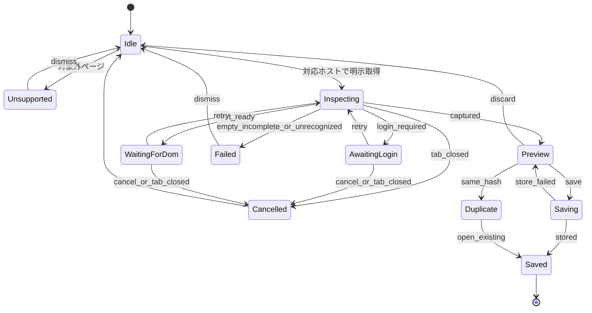

# 方法

TrailogueのMVPは、Edge / Chrome拡張機能の中で完結する。サーバーは置かない。providerへの追加APIリクエストも送らない。取得元は、利用者が現在開いているタブのDocumentだけである。

## なぜ拡張機能か

保存したいのは、利用者がCopilotまたはChatGPTで実際に開いている会話である。通常会話には認証が必要であり、会話本体はJavaScriptで描画される。未ログインのHTTP取得では、利用者が見ている会話と同じDocumentを得られない。

ブラウザ拡張機能なら、利用者が普段どおりサインインして開いたタブで、明示的な操作を受けたときだけ会話を読める。Trailogueはパスワード、Cookie、トークン、providerのlocalStorageを受け取らない。

参照:

- [Share conversations and responses in Microsoft Copilot](https://support.microsoft.com/en-us/microsoft-365-copilot/share-conversations-responses-in-microsoft-copilot)
- [Sharing conversations and scheduled tasks in ChatGPT](https://help.openai.com/en/articles/7925741-chatgpt-shared-links-faq)

## 利用者の流れ

1. 利用者は、保存したいCopilotまたはChatGPTの会話をブラウザで開く。必要なサインインはproviderのページで普段どおり行う。
2. その会話タブで拡張機能のボタンを押す。popupは使わない。
3. 現在のタブが対応ホストでなければ、ダッシュボードに理由を示し、取得しない。
4. 対応ホストなら、静的content scriptへ明示的な取得要求を送る。
5. provider adapterがDocument内の既知の会話構造を認識し、会話全体を構造化して取り出す。
6. ダッシュボードを通常のタブで開くか既存タブを前面にし、保存前に全文プレビューを出す。
7. 同一内容が保存済みなら、新規保存せず既存の記録を開く。
8. 同じ会話でも内容が違えば、古い記録を残したまま新しい記録として保存する。
9. 保存後は原文、思考経路、Markdown書き出しを同じ記録から使う。

Trailogueは取得元の会話タブを開閉しない。ページ遷移もしない。

## 対象ページ

対象ホストは次のHTTPSページだけである。

| Provider | 種別 | URL |
| --- | --- | --- |
| copilot | 通常会話 | `https://copilot.cloud.microsoft/chat/conversation/{conversationId}` |
| copilot | 共有会話 | `https://copilot.cloud.microsoft/chat/share/{token}` |
| chatgpt | 通常会話 | `https://chatgpt.com/c/{conversationId}` |
| chatgpt | 共有会話 | `https://chatgpt.com/share/{shareId}` |

各識別子は空でない1つのパスセグメントである。ページ判定ではクエリとフラグメントを無視する。`http`、他ホスト、余分なパスセグメント、ホーム、設定、一覧は対象外である。URLが一致しても、adapterが既知の会話構造を認識できなければ取得しない。

各記録の `sourceId` は、Document内で確認できたproviderの会話識別子を使う。通常会話と共有会話の双方で元会話の同じ識別子を確認できる場合は同じ値になる。Documentから識別子を確認できない形式では、URLの該当パスセグメントを使う。クエリとフラグメントは含めず、tokenらしき値をデコードして別の識別子を推測しない。

## 取得

content scriptはページ表示のたびに取得または保存しない。利用者が会話タブで拡張機能のボタンを押したことによる、明示的な取得要求にだけ応答する。

adapterは、すでに読み込まれたDocumentだけを見る。返すのは `RawCapture` か失敗であり、保存用に本文をMarkdownへ変換しない。

1. ページ内の埋め込み会話データがあれば、それを解釈する。Copilotでは inline script の `window.__staticRouterHydrationData` を読む。通常会話は `loaderData["chat-history"].store.rawConversationResponse`、共有会話は `loaderData["chat-share-redeem"].store.rawConversationResponse` である。この script は `#root` 内にあり、描画後に消える。content script は `document_start` で追加された script のテキストだけを保持し、取得要求のときに Document 内の script を優先して解釈する。保持分は、保持したときのパスと現在のパスが一致するときだけ使う。ChatGPT共有会話は `script#__WEB_MOBILE_DATA__` の `conversation.messages` を読む。
2. 埋め込みデータが無い、または会話として成立しなければ、表示済みの会話DOMを読む。確認できた ChatGPT通常会話は、`data-chatgpt-search-message-ids`、ユーザー見出し「あなたの発言:」、`data-conversation-role="assistant"` の文書順である。`data-virtualized-turn-content` があるページは、見えている発言だけでは全件とみなさない。
3. どちらも成立しなければ失敗とする。Copilotでアプリの枠だけがあり、使える hydration script が無いときは会話不完全とする。

`document.body.innerText` の一括保存は成功扱いにしない。サインイン文言、ナビゲーション、ボタン名が軌跡へ混ざるためである。

「表示済み」はビューポート内だけを意味しない。ただし、仮想スクロールによって一部の発言しかDOMに存在せず、埋め込みデータからも全件を確認できない場合、そのDOMだけを部分的な会話として成功させない。全件数を確認できないままの自動スクロール収集はMVPへ入れず、`incomplete_conversation` とする。

発言の順序はDocument上の出現順である。時刻が欠けていても、時刻で並べ替えない。

各発言は `user`、`assistant`、`unknown` のいずれかである。役割を判定できなければ `unknown` とし、assistantへ寄せない。

保存する本文は、表示されたテキスト、または埋め込みデータ中の発言テキストである。前後の空白だけを除き、改行コードはLFへ揃える。行の内側、空行、表記は変えない。画像、添付ファイル、参照されたMicrosoft 365ファイルはダウンロードしない。テキストの無い発言は、順序を保つために空の本文のまま残し、プレビューでその件数を警告する。

会話タイトルは、会話自身の見出しが特定できた場合だけ使う。ページのサイト名（`Microsoft Copilot`、`ChatGPT` など）はタイトルにしない。見出しが無ければ、最初のユーザー発言の先頭80文字を表示用タイトルにする。文字数はUnicodeコードポイント単位で数える。本文側のその発言は省略しない。

## 思考経路

MVPの思考経路は、保存済み発言を順序どおり縦に並べたものである。AIによる命名、要約、重要度、脱線の除去は加えない。長い発言も省略表示にしない。

経路は保存データから毎回導出する。発言本文とは別の「経路用の短縮テキスト」を保存しない。

同じ会話を後日もう一度取り込むことがある。内容ハッシュが同じなら同じ軌跡である。内容が増えている、または変わっているなら、過去の記録を上書きせず、取得日時の違う記録として残す。上書きは思考の変遷を消す。

## 失敗時の表示

失敗した取得は保存しない。プレビューまで到達した記録は、IndexedDBへの保存が失敗しても画面上に残し、その場からMarkdownを書き出せる。

| 状態 | 利用者に見せる内容 | 次の操作 |
| --- | --- | --- |
| 対象外ページ | CopilotまたはChatGPTの対応会話タブで実行する | 会話を開いて再実行 |
| サインイン待ち | 現在のタブでサインインし、会話を表示する | 再取得、中止 |
| 会話の描画待ち | 現在のタブで会話の表示を待っている | 最初の10秒は自動再試行。その後は再取得、中止 |
| 取得成功 | 発言の全文プレビュー | 保存、破棄 |
| 同一内容 | 同じ軌跡は保存済みであり、既存の記録へ移れる | 既存を開く |
| 内容が変化 | 同じ会話の別の記録として残せる。以前の記録は削除しない | 保存、破棄 |
| 会話ゼロ | 会話を読めなかったので保存していない | 再取得、中止 |
| 会話不完全 | 仮想化などにより全発言を確認できず、保存していない | ページを再表示して再取得 |
| 構造不明 | この版のadapterでは会話ページの構造を読めなかった | 再取得、中止 |
| タブを閉じた | 取得を中断した | 最初からやり直す |
| 保存失敗 | 記録はまだこの画面にある | 保存を再試行、Markdownを書き出す |

サインイン待ちに自動タイムアウトは設けない。ログイン操作中に失敗へ切り替えない。中止は利用者が選ぶ。

描画待ちは、ページ読み込み後におよそ10秒まで再試行する。それを超えて会話コンテナも埋め込みデータも無い場合は、構造不明と区別して「会話の表示を待っています」を維持し、自動では失敗確定にしない。利用者が再取得する。

構造不明は、ページが読み込み済みで、既知の会話構造へ一致しない場合である。会話不完全は、既知の構造へ一致しているが全発言を取得できない場合である。どちらも空の成功や本文推測で埋めない。

## 状態遷移

取得セッションは次の純粋な遷移で進む。UIとタブ操作は、この遷移結果を実行するだけにする。

`login_required` のあいだは、利用者がサインインして会話を表示したあとに再取得を選ぶ。`not_ready` は最初のおよそ10秒まで2秒間隔で同じ取得元タブへ再取得する。10秒を超えても会話が現れなければ自動再取得を止め、表示は「会話の表示を待っています」のままにする。その後の再取得は利用者が選ぶ。
